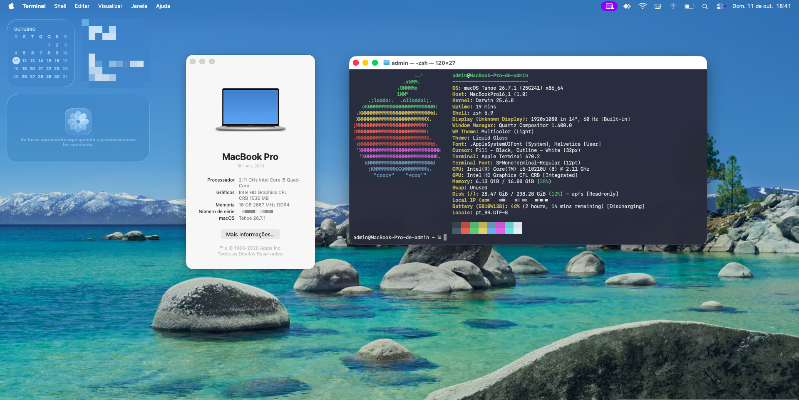
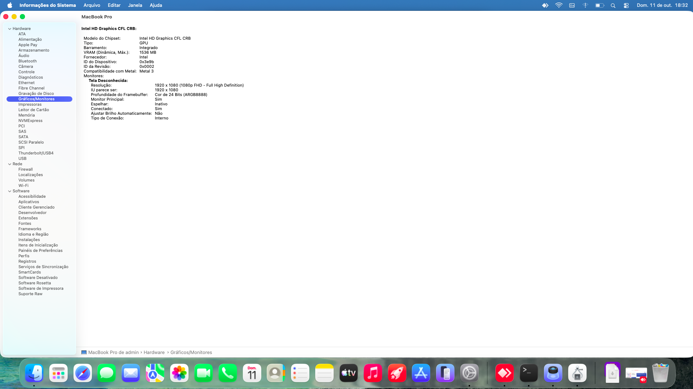
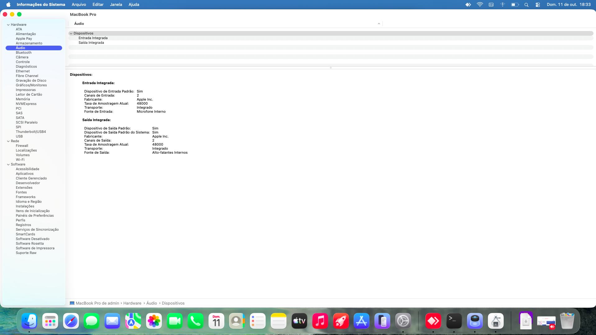
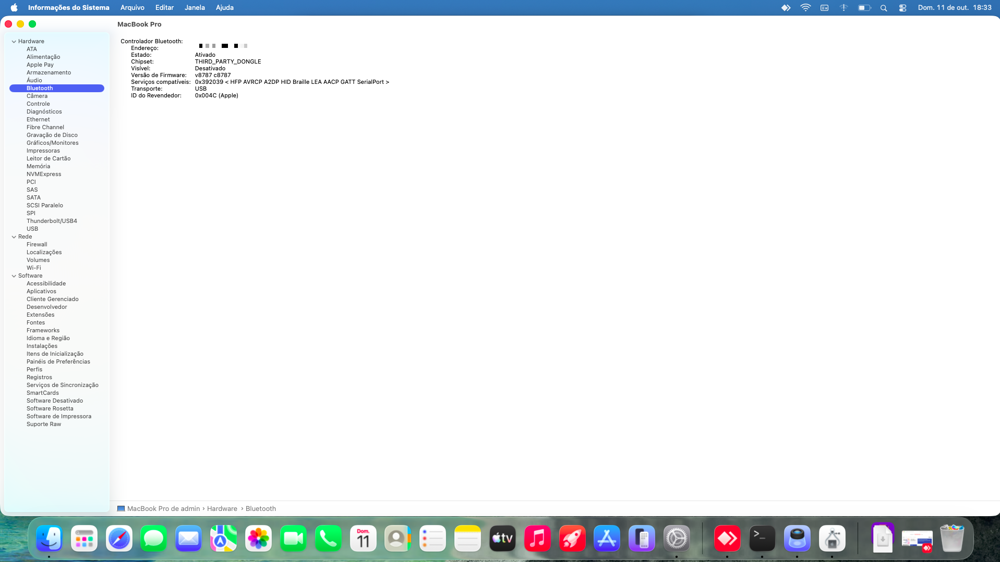
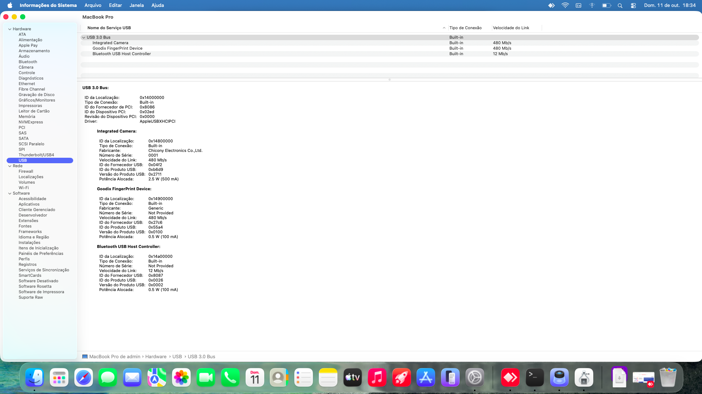
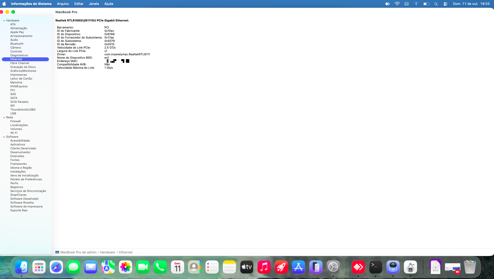
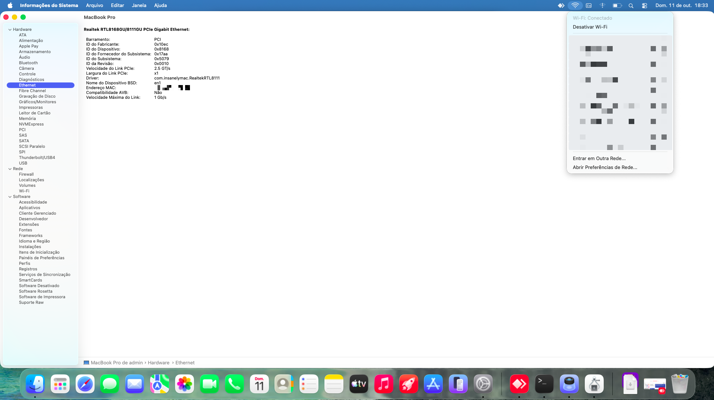
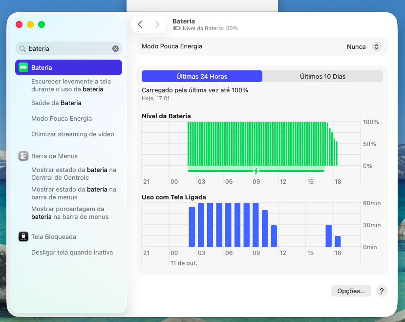

<div align="center">

# OpenCore EFI · Lenovo ThinkPad E14 Gen 1 · macOS Tahoe 26


[Hardware](#hardware) · [Screenshots](#screenshots) · [Configuration](#configuration-and-why) · [Before you start](#before-you-start) · [Post-install](#post-install) · [Credits](#credits)

🇺🇸 **English** · 🇧🇷 [Português](README.pt-BR.md)

</div>

OpenCore EFI for the **Lenovo ThinkPad E14 Gen 1 (20RA/20RB)** running **macOS Tahoe 26.7.1**,
built for educational purposes. It is based on OpenCore's official `Sample.plist` and on
components downloaded straight from their original repositories.



> ⚠️ **Do not use it before generating your own SMBIOS** (see below). Hackintosh is not supported
> by Apple: use it at your own risk and keep backups of your data.

## Hardware

| Component | Model | Status |
|---|---|---|
| CPU | Intel Core i5-10210U (Comet Lake) | ✅ |
| iGPU | Intel UHD 620 | ✅ acceleration, brightness, HDMI |
| Audio | Realtek ALC257 | ✅ requires a root patch on Tahoe (see below) |
| Ethernet | Realtek RTL8111 | ✅ |
| Wi-Fi | Intel AX201 | ✅ via itlwm + [HeliPort](https://github.com/OpenIntelWireless/HeliPort) |
| Bluetooth | Intel AX201 | ✅ |
| Touchpad | ELAN | ✅ via VoodooPS2 |
| TrackPoint | PS/2 | ✅ |
| Keyboard | Brazilian ABNT2 | ✅ including the `/?°` key |
| Camera | Integrated (USB) | ✅ |
| Battery | — | ✅ percentage and charging |
| Sleep | — | ✅ |
| Fingerprint reader | Goodix | ❌ no macOS driver |
| AirDrop / Sidecar / Handoff | — | ❌ not supported by Intel Wi-Fi drivers |

## Screenshots

Screenshots of the system running this EFI (serial number, IP, MAC/Bluetooth addresses, location and
third-party networks are hidden).

**About This Mac + fastfetch** — macOS Tahoe 26.7.1 (25G241), MacBookPro16,1, i5-10210U


| | |
|---|---|
| **Graphics** — UHD 620 with Metal 3 | **Audio** — built-in input and output |
|  |  |
| **Bluetooth** — on, firmware loaded | **USB** — camera, Bluetooth and fingerprint reader |
|  |  |
| **Ethernet** — RTL8111 at 1 Gb/s | **Wi-Fi** — connected via itlwm/HeliPort |
|  |  |
| **Battery** — reading and charge history | |
|  | |

*(Screenshots are from a system with the macOS interface in Portuguese.)*

## Versions

- **OpenCore:** 1.0.8 (RELEASE)
- **SMBIOS:** MacBookPro16,1

| Kext | Version | Purpose |
|---|---|---|
| Lilu | 1.7.2 | Plugin framework |
| VirtualSMC + SMCProcessor + SMCBatteryManager | 1.3.8 | SMC, sensors and battery |
| WhateverGreen | 1.7.1 | iGPU |
| AppleALC | 1.9.8 | Audio (`layout-id 15`) |
| ECEnabler | 1.0.6 | Battery readings |
| VoodooPS2Controller | 2.3.7 | Keyboard, ELAN touchpad and TrackPoint |
| BrightnessKeys | 1.0.3 | Brightness keys |
| RealtekRTL8111 | 2.5.0 | Ethernet |
| itlwm | 2.3.0 | Intel Wi-Fi |
| IntelBluetoothFirmware + IntelBTPatcher | 2.5.1 (lshbluesky fork, Tahoe support) | Bluetooth |
| BlueToolFixup | 2.7.2 | Bluetooth |
| NVMeFix | 1.1.3 | NVMe |
| USBToolBox + UTBMap | 1.2.0 | USB map |
| CPUFriend | 1.3.0 | Power management (**disabled**, see below) |

**ACPI** (Dortania prebuilts): SSDT-PLUG-DRTNIA, SSDT-EC-USBX-LAPTOP, SSDT-AWAC, SSDT-PNLF.

## Configuration and why

| Item | Value | Reason |
|---|---|---|
| iGPU | `AAPL,ig-platform-id 00009B3E`, `device-id 9B3E0000`, stolenmem/fbmem | UHD 620 (Comet Lake, `0x9B41`) spoofed as `0x3E9B` |
| HDMI | con1/con2 as HDMI + `hda-gfx onboard-1` | Video and audio over HDMI |
| SMBIOS | MacBookPro16,1 + `agdpmod=vit9696` | With 16,2 (Ice Lake), video decoding and YouTube playback failed |
| Ethernet | RealtekRTL8111 **2.5.0** with EEE/TSO4/TSO6/CSO6 disabled | Version 3.0.0 and EEE kept dropping the link, causing `PKDownloadError 8` during installation |
| Touchpad | VoodooPS2 only, no VoodooI2C/VoodooSMBus | VoodooPS2 already supports ELAN. VoodooI2C left the touchpad half-working, and VoodooSMBus 2.2 doesn't even load on Comet Lake (it doesn't match the `8086:02a3` SMBus controller) |
| Keyboard | `Use ISO layout keyboard = true` + `Custom ADB Map e01d=5e` | On the ThinkPad ABNT2 keyboard, the `/?°` key sends the Right Ctrl scancode (`e01d`) |
| USB | UTBMap with HS01–HS10 + SS01–SS04 (14 ports) | Without a map, the camera and Bluetooth (internal port 10) fell outside the 15-port limit |
| Bluetooth | `-btlfxallowanyaddr` + NVRAM `bluetoothExternalDongleFailed=00` and `bluetoothInternalControllerInfo=00…` (Add + Delete) | Fixes the Tahoe `Address: NULL` / `BCM_4350C2` issue ([issue #513](https://github.com/OpenIntelWireless/IntelBluetoothFirmware/issues/513)) |
| CFG Lock | `AppleXcpmCfgLock = true` | The Lenovo BIOS doesn't allow disabling CFG Lock |
| SIP | `csr-active-config = 03080000` | Required for the audio root patch |
| Security | `SecureBootModel = Disabled` | Required to install Tahoe |
| Boot | `ShowPicker = false` | Boots straight into macOS. Hold **Esc** at power-on to show the picker |

## Before you start

### 1. SMBIOS (required)
`SystemSerialNumber`, `MLB`, `SystemUUID` and `ROM` are **empty**. To fill them in:
1. Generate them with [GenSMBIOS](https://github.com/corpnewt/GenSMBIOS) or OpenCore's `macserial`, using the **MacBookPro16,1** model.
2. Check the serial at [checkcoverage.apple.com](https://checkcoverage.apple.com). It must come back as **invalid**. If it matches a real Mac, generate another one.
3. For `ROM`, use the MAC address of your Ethernet card.

### 2. BIOS
- Secure Boot: Disabled
- SGX: Disabled
- Startup: UEFI Only
- CSM: Disabled
- Fast Boot: Disabled

### 3. Installation
- Use a **network cable**, because Wi-Fi doesn't work in Recovery.
- If you get `PKDownloadError 8`, check the clock in the Recovery Terminal with `date`. It must be in UTC. Fix it with `date MMDDhhmmYY`.

## Post-install

### Audio on Tahoe
macOS 26 no longer ships AppleHDA. To get sound:
1. Install the **KDK** that exactly matches your build, from [dortania/KdkSupportPkg](https://github.com/dortania/KdkSupportPkg/releases).
2. Apply the audio root patch with a root-patching tool. This repository does **not** include one.
3. **Repeat this after every macOS update.**

### Wi-Fi
Install [HeliPort 1.5.0](https://github.com/OpenIntelWireless/HeliPort/releases). To start it automatically, use a LaunchAgent (`open -a HeliPort` with `RunAtLoad`).

### CPUFriend (optional, recommended)
The `CPUFriendDataProvider` is generated **per machine**:
1. Run [one-key-cpufriend](https://github.com/stevezhengshiqi/one-key-cpufriend) on the Mac itself. I used LFM 800 MHz and EPP Balance Power.
2. Put `CPUFriendDataProvider.kext` in `OC/Kexts`.
3. Enable both entries in `config.plist`.

### Power
```
sudo pmset -a hibernatemode 0 standby 0 autopoweroff 0 proximitywake 0 powernap 0
```

## Credits

- [Acidanthera](https://github.com/acidanthera): OpenCore, Lilu, WhateverGreen, AppleALC, VirtualSMC, VoodooPS2, NVMeFix, BrightnessKeys, CPUFriend, BrcmPatchRAM
- [Dortania](https://dortania.github.io): guides and prebuilt SSDTs
- [OpenIntelWireless](https://github.com/OpenIntelWireless): itlwm, HeliPort, IntelBluetoothFirmware
- [lshbluesky](https://github.com/lshbluesky/IntelBluetoothFirmware): IntelBluetoothFirmware fork with Tahoe support
- [Mieze](https://github.com/Mieze/RTL8111_driver_for_OS_X): RealtekRTL8111
- [1Revenger1](https://github.com/1Revenger1/ECEnabler): ECEnabler
- [USBToolBox](https://github.com/USBToolBox/kext)

Each component keeps the license of its original project. OpenCore is distributed under BSD-3-Clause
(see [`licenses/OpenCore-BSD-3.txt`](licenses/OpenCore-BSD-3.txt)).
